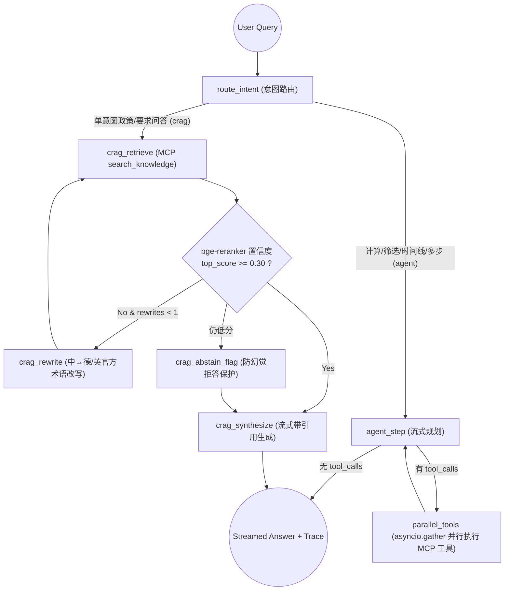

# 🇩🇪 DeStudy Agent — 德国硕士申请 AI Agent

面向中国学生的德国硕士申请智能助手，整合 **结构化项目库（SQLite 1,611+ 德国英语硕士）** + **跨语言混合 RAG（中文问 → 检索德/英官方原文 → 带引用作答）** + **自研 MCP v2 Server** + **双引擎 Agent（手写 ReAct + LangGraph 状态机 / Corrective RAG / 并行工具 / 流式输出）** + **本地可观测性与三层离线评测体系**。



## 快速开始

```bash
python3.13 -m venv .venv && source .venv/bin/activate
pip install -r requirements.txt
cp .env.example .env            # 填入 OPENAI_API_KEY / OPENAI_BASE_URL / OPENAI_MODEL

# 1) 构建数据与索引
python -m data_pipeline.ingest_daad        # 拉取 DAAD 全德英语授课硕士目录 (1,604 项目)
python -m data_pipeline.crawl --clean      # 抓取并去噪目标高校 + DAAD/uni-assist/APS 官方页面
python -m data_pipeline.extract_programs   # LLM + Pydantic 从官方页面抽取结构化项目字段入 SQLite
python -m data_pipeline.programs_db        # 合并构建 data/programs.db
python -m data_pipeline.chunk              # 按标题结构切块 -> data/chunks.jsonl
python -m data_pipeline.index              # 本地 bge-m3 向量化 -> data/qdrant/

# 2) 使用
streamlit run app/streamlit_app.py         # 3 标签 Web UI：支持 LangGraph / ReAct 切换、流式输出、1,611 项目库、监控面板
python -m agent.cli                        # 终端流式对话（默认 LangGraph，可加 --engine react）
python -m rag.answer "TU Dresden 计算机硕士申请截止日期？"

# 3) 三层评测 & 单元测试
python -m evaluation.eval_retrieval [--rewrite] [--no-filter]  # 检索消融 (Recall@5 / MRR)
python -m evaluation.eval_e2e --limit 10                       # 端到端 Faithfulness / Relevancy / 拒答率
python -m evaluation.eval_agent --engine langgraph             # Agent 轨迹评测（支持 langgraph / react 对照）
pytest                                                         # 17 项单元与 MCP stdio 集成测试

# 4) Docker Compose 一键部署（挂载本地 data/ 与 HuggingFace 模型缓存）
docker compose up --build -d                   # 启动 Streamlit Web UI -> http://localhost:8501
docker compose --profile mcp up --build -d     # 同时启动独立 HTTP MCP Server -> http://localhost:8765/mcp
```

> 也可以直接用 `make build-data`、`make ui`、`make cli`、`make test`、`make eval`、`make docker-up` 快捷运行。

## 在 Claude Desktop / Cursor 中使用 MCP Server

```json
{
  "mcpServers": {
    "destudy": {
      "command": "/ABS/PATH/destudy-agent/.venv/bin/python",
      "args": ["-m", "mcp_server.server"],
      "cwd": "/ABS/PATH/destudy-agent"
    }
  }
}
```

MCP 三大原语：
- **Tools**：`search_knowledge`, `search_programs`, `get_program_stats`, `convert_grade`, `calc_blocked_account`, `build_timeline`
- **Resources**：`destudy://programs`, `destudy://programs/{program_id}`
- **Prompts**：`application_checklist`, `motivation_letter_review`

## 项目库规模（SQLite `data/programs.db`）

三层数据源按优先级合并（人工核对官方页 > LLM Pydantic 结构化抽取 > DAAD 国际项目目录）：
- **总项目数**：`1,611`（覆盖 **191** 所德国高校）
- **免非欧盟学费（0 EUR）**：`927` 个项目
- **CS / AI / Data Science / Informatics 相关**：`237` 个项目
- 支持按关键词（含 `OR` / 逗号多词匹配）、院校、城市、入学学期（WS/SS）、非欧盟学费上限、雅思上限、GRE 政策组合筛选。

---

## 三层评测结果

### 1. 跨语言检索消融（30 道中→德/英测试集，去噪扩容后 612 chunks）

| 检索方案 | Recall@5 | MRR | 说明 |
|---|---:|---:|---|
| `bm25` | 0.200 | 0.139 | 纯词面匹配在中文问→英/德文页场景召回低 |
| `dense` (`bge-m3`) | 0.967 | 0.878 | 多语言语义对齐显著跃升，仅漏 1 条边界条款 |
| `hybrid`（BM25 + dense 等权 RRF） | 0.800 | 0.636 | 等权 RRF 被 BM25 跨语言噪声拉低排名 |
| `hybrid_rerank`（+ `bge-reranker-v2-m3`） | **1.000** | **0.942** | 混合 Top-30 候选 + 交叉编码重排，兼顾召回与精度 |

### 2. 端到端生成质量 & 防幻觉拒答（LLM-as-a-Judge）

| 评测维度 | 样本数 | 结果 |
|---|---:|---:|
| Faithfulness（忠实度） | 10 道可答问题 | **0.975** |
| Answer Relevancy（相关性） | 10 道可答问题 | **0.990** |
| Citation Rate（强制引用覆盖率） | 10 道可答问题 | **100.0%** |
| Hallucination Refusal Rate（防幻觉拒答率） | 8 道库外/陷阱前提题 | **100.0% (8/8)** |

### 3. 双引擎 Agent 轨迹与效率对照（`evaluation/eval_agent.py`，12 项多步任务）

| 指标 | 手写 ReAct (`react_agent.py`) | LangGraph + CRAG (`langgraph_agent.py`) |
|---|---:|---:|
| Tool Selection Accuracy（工具选择准确率） | **100.0% (12/12)** | **100.0% (12/12)** |
| Answer Factuality / Pass Rate（任务通过率） | **100.0% (12/12)** | **100.0% (12/12)** |
| Tool Error Rate（工具错误率） | **0.0%** | **0.0%** |
| 单意图知识问答 Token（如 APS 费用 / 弗莱堡学费 / TUDA GRE） | `4,729–8,993` | **`2,124–2,653`（降幅 49%–75%）** |
| CRAG 低置信度自动改写触发（库外题实测） | — | **1 次自动德/英改写重试 → 成功拒答** |
| 平均 Token / 轮（12 题均值） | 7,707 | **7,601** |
| P50 / Avg 端到端延迟 | **17.51s / 16.28s** | 20.73s / 23.18s（含路由开销与本地单卡 MPS 并发竞争） |
| 交互体验 | 非流式 | **原生 Token 流式输出 + 节点级状态可视化** |

> **架构取舍分析（面试重点）**：LangGraph 的意图路由 + CRAG 分支在单意图政策问答上省掉了完整多工具 Schema 上下文，**Token 成本下降 49%–75%**，并在库外题上显式触发低置信度自纠错与拒答保护；同时实测发现，路由器额外的一次 LLM 调用叠加本地单卡 MPS 并发重排竞争会抬高复杂多步任务的端到端总延迟——生产化优化方向为「轻量规则/小模型路由 + 独立批处理 Reranker 服务」。

---

## 工程设计要点与踩坑复盘

| 问题 | 解决与复盘 |
|---|---|
| 中文提问 vs 德/英官方网页 | `bge-m3` 跨语言向量 + LLM 英/德术语改写 + `bge-reranker-v2-m3` 重排 |
| 等权 RRF 在跨语言场景拉低 MRR | 消融实验定位为 BM25 词面噪声被等权推前；改由混合检索扩大候选池（Top-30）再交 Cross-Encoder 精排 |
| 元数据过滤丢召回 | Qdrant 原生 `Filter(should=[general, MatchText(university)])` 预过滤，避免小语料高校被 Top-K 截断 |
| 爬虫噪音与重复 URL | 去跟踪参数（`pk_campaign` / `utm_*`）+ 全局/分源黑名单过滤隐私页、非德国页面及门户排障页，文档从 135 精简到 115（扩容 3 所高校后总块数反而更干净） |
| 评测驱动发现的两个真实 Bug | ① 端到端评测早期 Faithfulness 虚低（0.588），定位为给裁判的 `sources` 被截断至 300 字导致误判，改为传递与生成器一致的完整 `context` 后恢复至 0.975；② Agent 轨迹评测发现 LLM 传入 `"AI OR ML"` 时单次 SQL `LIKE` 失配，升级多词 `OR` 拆分后任务通过率升至 100% |

## 项目结构

```
data_pipeline/  crawl.py  ingest_daad.py  extract_programs.py  programs_db.py  chunk.py  index.py  sources.yaml
rag/            retriever.py (hybrid+rerank)  query_rewrite.py  answer.py  models.py
mcp_server/     server.py (MCPServer, mcp v2)  tools.py (纯函数 + SQLite 查询)
agent/          react_agent.py (手写 ReAct)  langgraph_agent.py (LangGraph + CRAG + 并行工具 + 流式)  memory.py  tracer.py  cli.py
app/            streamlit_app.py (双引擎流式对话 / 1,611 项目库筛选 / 可观测与评测面板)
prompts/        agent_system.md  router.md  rag_answer.md  query_rewrite.md  extract_program.md
evaluation/     testset.jsonl  refusal_testset.jsonl  agent_testset.jsonl  eval_retrieval.py  eval_e2e.py  eval_agent.py
data/           programs.yaml  extracted_programs.json  facts.yaml  programs.db (generated)
tests/          test_tools.py  test_rag.py  test_mcp_server.py  test_db_and_tracer.py  test_langgraph.py
Dockerfile / docker-compose.yml / Makefile
```

> ⚠️ 所有申请信息以学校官网与使领馆最新公告为准。爬虫遵守 `robots.txt` 并限速，仅抓取公开页面。
